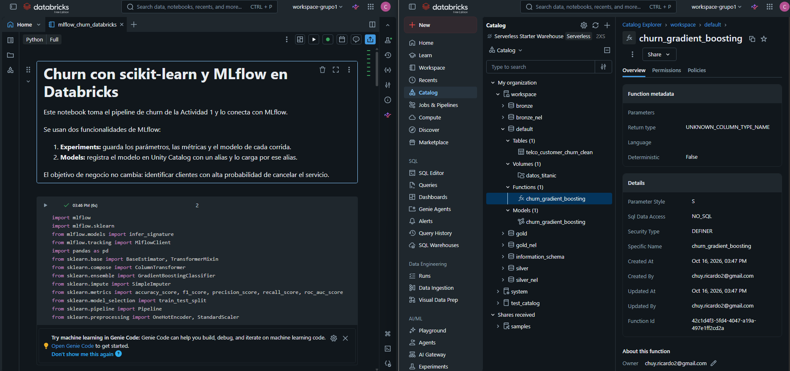
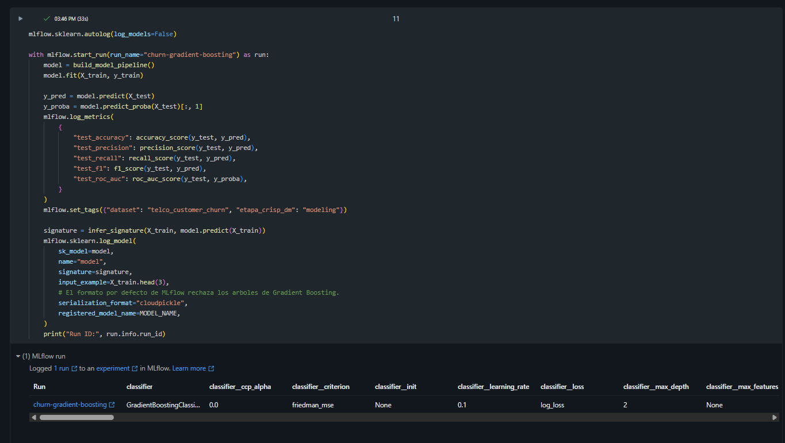
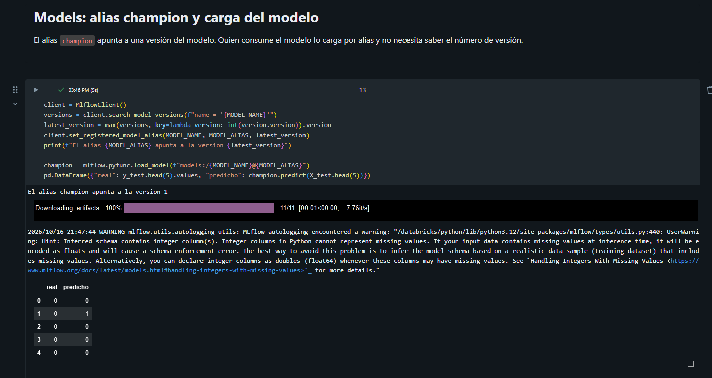
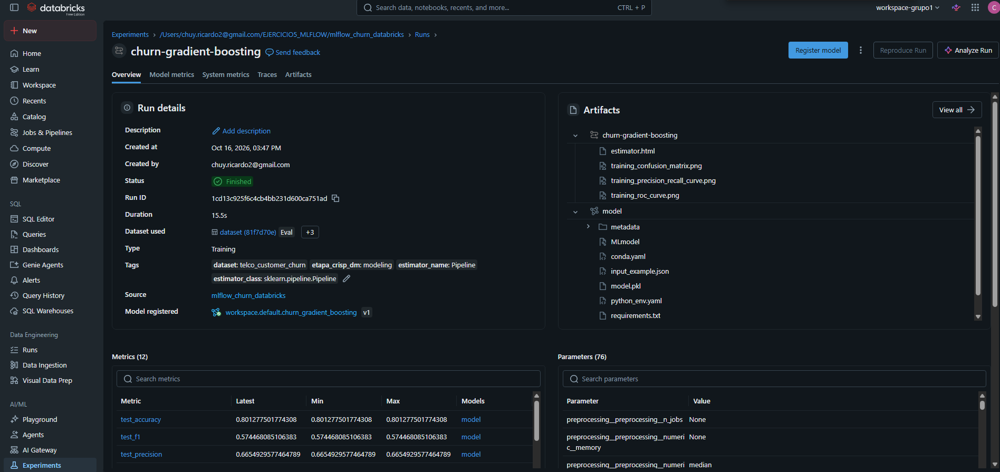
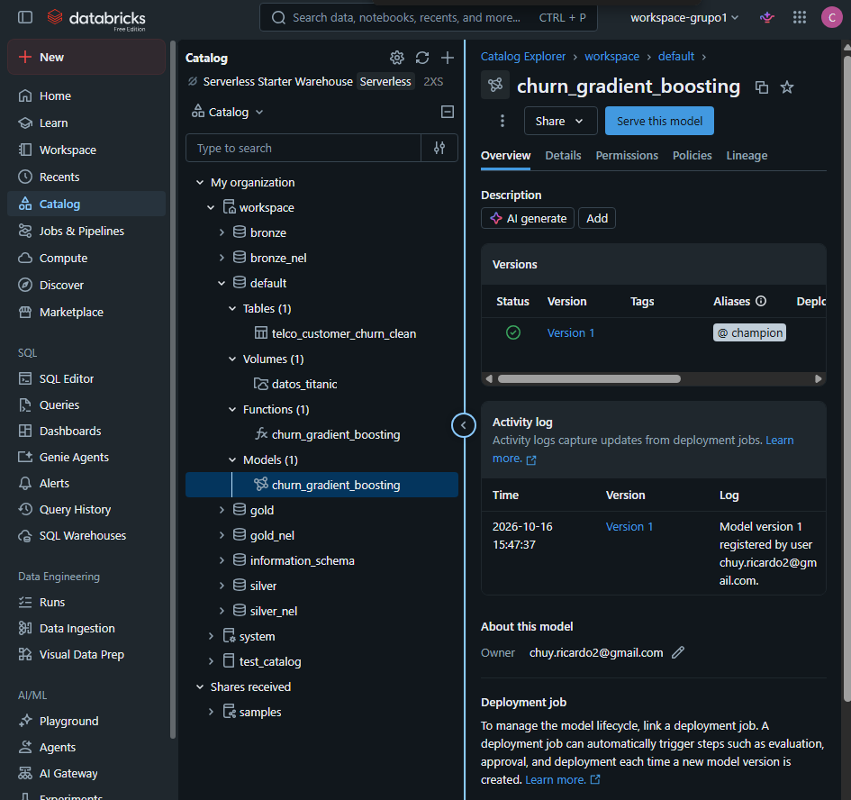
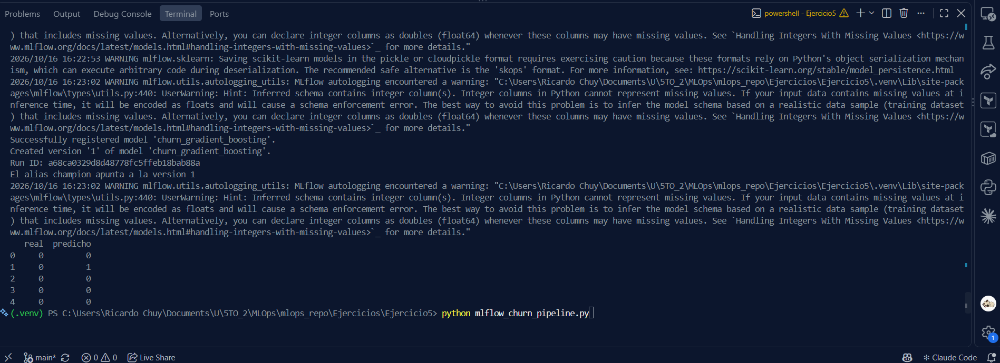

# **Investigación: uso de MLflow en la plataforma de Databricks**

Daniel Dubon 22233

Diego Valenzuela 22309

Joaquin Puente 22296

Sergio Orellana 221122

Nelson Bravatti 22434

Ricardo Chuy 221007

Rodrigo Mansilla 22611

## **1\. Qué es MLflow en Databricks**

MLflow es una plataforma de código abierto para manejar el ciclo de vida de modelos de machine learning. Databricks la ofrece como servicio administrado: el servidor de tracking, el registro de modelos y el almacenamiento de artefactos ya vienen configurados en el workspace, y el registro de modelos está integrado con Unity Catalog para tener permisos, linaje y descubrimiento de modelos entre workspaces.

## **2\. MLflow \+ Databricks**

| Funcionalidad | Qué hace | Dónde se ve en Databricks |
| :---- | :---- | :---- |
| Experiments (tracking) | Guarda parámetros, métricas, artefactos y versión del código de cada corrida (run) y permite compararlas. | Sección Experiments del workspace y panel lateral del notebook |
| Autologging | Registra parámetros y métricas automáticamente para scikit-learn, XGBoost, PyTorch y otras librerías con mlflow.autolog(). Databricks lo activa por defecto en los clusters de Machine Learning. | Corridas creadas solas al llamar fit() |
| Logged Models (MLflow 3\) | Trata el modelo como una entidad propia, con sus métricas, parámetros y evaluaciones asociadas, y permite compararlo entre corridas. | Página del experimento, pestaña de modelos |
| Model signature e input example | Documenta columnas y tipos de entrada y salida y valida los datos al predecir. | Página del modelo registrado |
| Model Registry en Unity Catalog | Versiona modelos con nombre de tres niveles (catálogo.esquema.modelo), con permisos, linaje y descripción. | Catalog Explorer, sección Models |
| Aliases | Nombres móviles como champion que apuntan a una versión. Reemplazan los stages Staging y Production del registro antiguo. | Página de versiones del modelo |
| Feature Engineering / Feature Store en Unity Catalog | Tablas de features reutilizables con llave primaria. El modelo guarda de qué tabla salieron sus features, así que en inferencia se buscan solas. | Catalog Explorer, tablas con llave primaria |
| Evaluación de modelos | mlflow.models.evaluate calcula métricas y genera gráficas (matriz de confusión, curva ROC) como artefactos. | Artefactos de la corrida |
| Model Serving | Publica un modelo registrado como endpoint REST administrado. | Sección Serving |
| Deployment jobs (MLflow 3\) | Automatizan evaluación, aprobación y despliegue cuando se crea una versión nueva del modelo. | Pestaña de la página del modelo y Workflows |
| AutoML | Entrena varios modelos y deja cada intento como corrida de MLflow, con un notebook generado para cada uno. | Sección Experiments |
| MLflow Tracing y evaluación de GenAI | Registra las llamadas de un agente o LLM paso a paso para depurar y evaluar aplicaciones de IA generativa. | Pestaña Traces del experimento |

## **3\. Preguntas de la investigación**

### **¿Qué usos puede tener para proyectos de Machine Learning?**

> * **Reproducibilidad:** cada corrida guarda parámetros, versión del código, librerías y datos de entrada, así que se puede repetir un resultado meses después.  
> * **Comparar experimentos:** la tabla y las gráficas del experimento muestran qué combinación de hiperparámetros o qué algoritmo rinde mejor, sin hojas de cálculo manuales.  
> * **Trabajo en equipo:** los experimentos viven en el workspace, por lo que varias personas ven y comparan las mismas corridas.  
> * **Versionado y gobernanza de modelos:** el registro en Unity Catalog guarda versiones, descripciones, permisos y linaje (qué tabla y qué corrida produjeron el modelo).  
> * **Paso a producción ordenado:** con alias y deployment jobs se promueve una versión sin cambiar el código de quien la consume.  
> * **Despliegue:** un modelo registrado se publica como endpoint con Model Serving o se usa en predicciones por lotes en un job.  
> * **Evitar diferencias entre entrenamiento e inferencia:** con Feature Store las mismas features se calculan una sola vez y se reutilizan.  
> * **Auditoría:** queda registro de quién entrenó qué, cuándo y con qué métricas.

### **¿Qué etapas de CRISP-DM puede cubrir esta herramienta?**

| Etapa de CRISP-DM | Cobertura | Funcionalidades que la apoyan |
| :---- | :---- | :---- |
| 1\. Comprensión del negocio | Mínima | Solo documentación: tags y descripciones en experimentos y modelos. Los objetivos del negocio se definen fuera de la herramienta. |
| 2\. Comprensión de los datos | Parcial | Registro del dataset usado en cada corrida (mlflow.log\_input), tablas de Unity Catalog con linaje y los notebooks de exploración de Databricks. |
| 3\. Preparación de los datos | Parcial | Feature Engineering en Unity Catalog para crear y reutilizar features. Si el preprocesamiento va dentro del Pipeline de scikit-learn, se versiona junto con el modelo. |
| 4\. Modelado | Alta | Experiments, autologging, comparación de corridas, AutoML y Logged Models. |
| 5\. Evaluación | Alta | Métricas en cada corrida, mlflow.models.evaluate, comparación contra el modelo vigente y validación antes de promover una versión. |
| 6\. Despliegue | Alta | Model Registry con alias, Model Serving, inferencia por lotes y deployment jobs. |

MLflow cubre sobre todo las etapas 4, 5 y 6\. Las etapas 2 y 3 se cubren en conjunto con Unity Catalog y Feature Engineering, y la etapa 1 queda fuera de la herramienta. Después del despliegue, el monitoreo del modelo en producción también se apoya en Databricks, pero ya no es parte del ciclo CRISP-DM clásico.

## **4\. Pipeline de scikit-learn adaptado: Jupyter Notebook**

Se adaptó el pipeline de churn de la Actividad 1. Usa el dataset Telco Customer Churn, con 7,043 clientes. El pipeline tiene cuatro partes:

> * **Extracción:** selecciona las columnas y convierte TotalCharges a número.  
> * **Filtrado:** quita clientes duplicados y valores poco creíbles.  
> * **Preprocesamiento:** imputa, escala y codifica las columnas.  
> * **Modelo:** GradientBoostingClassifier con los hiperparámetros ganadores de la Actividad 1.

La adaptación usa dos funcionalidades de MLflow:

> * **Experiments:** autologging de parámetros y métricas de entrenamiento. Las métricas de prueba se registran a mano: accuracy, precision, recall, F1 y ROC AUC.  
> * **Models:** el modelo se registra en Unity Catalog con su firma y un ejemplo de entrada. El alias champion apunta a la versión registrada y el modelo se carga por ese alias.

El notebook es `mlflow_churn_databricks.ipynb`. Se importa en Databricks y se corre en orden. La copia `mlflow_churn_databricks_results.ipynb` es la exportada desde Databricks, con los resultados de la ejecución.

**Enlace al notebook en el workspace de Databricks:** [https://dbc-6f97ab0d-932c.cloud.databricks.com/editor/notebooks/3915591326894887?o=7474651991590418#command/7273449974852842](https://dbc-6f97ab0d-932c.cloud.databricks.com/editor/notebooks/3915591326894887?o=7474651991590418#command/7273449974852842)

**Modelo registrado en Unity Catalog:** [https://dbc-6f97ab0d-932c.cloud.databricks.com/explore/data/functions/workspace/default/churn_gradient_boosting?o=7474651991590418](https://dbc-6f97ab0d-932c.cloud.databricks.com/explore/data/functions/workspace/default/churn_gradient_boosting?o=7474651991590418)

**Capturas:**



Captura 1. Notebook en Databricks a la izquierda y modelo registrado en el catálogo a la derecha.



Captura 2. Celda que entrena el pipeline y registra la corrida y el modelo en MLflow.



Captura 3. Celda que asigna el alias champion y carga el modelo por alias.



Captura 4. Corrida churn-gradient-boosting en Experiments, con sus métricas, parámetros, artefactos y el modelo registrado.



Captura 5. Modelo registrado en Unity Catalog, con la versión 1 y el alias champion.

## **5\. Pipeline de scikit-learn adaptado: archivo de Python**

La misma lógica está en el archivo mlflow\_churn\_pipeline.py. El script hace estos pasos:

> * Lee los datos, los limpia y los divide en entrenamiento y prueba.  
> * Entrena el pipeline y registra la corrida en MLflow.  
> * Registra el modelo y asigna el alias champion.  
> * Carga el modelo por alias y predice.

El script detecta si corre en Databricks. Allí registra el modelo en Unity Catalog. Fuera de Databricks guarda todo en un archivo SQLite local, para poder probarlo. Se ejecuta así:

```
python mlflow_churn_pipeline.py --catalog workspace --schema default
```

**Resultado de la prueba local:** se ejecutó con MLflow 3.17.1 y scikit-learn 1.9.1. Métricas en el conjunto de prueba: accuracy 0.801, precision 0.666, recall 0.505, F1 0.574 y ROC AUC 0.846. El modelo quedó como versión 1 con el alias champion.

**Enlace al repositorio de GitHub con el código del pipeline:** [https://github.com/SergioAle210/ML-Engineering/tree/main/Ejercicios/Ejercicio5](https://github.com/SergioAle210/ML-Engineering/tree/main/Ejercicios/Ejercicio5)

**Capturas:**



Captura 6. Ejecución del script en local: registra el modelo, asigna el alias champion y predice cargando por alias.

## **6\. Fuentes**

> * [Documentación de MLflow en Databricks](https://docs.databricks.com/mlflow/)  
> * [Notebook oficial: Models in Unity Catalog con MLflow 3](https://docs.databricks.com/notebooks/source/mlflow/models-in-uc-example-mlflow-3.html)  
> * [Entrenar modelos con features (Feature Engineering en Unity Catalog)](https://docs.databricks.com/aws/en/machine-learning/feature-store/train-with-declarative-features)  
> * [Notebook oficial: ejemplo básico de Feature Store con Unity Catalog](https://docs.databricks.com/notebooks/source/machine-learning/feature-store-with-uc-basic-example.html)