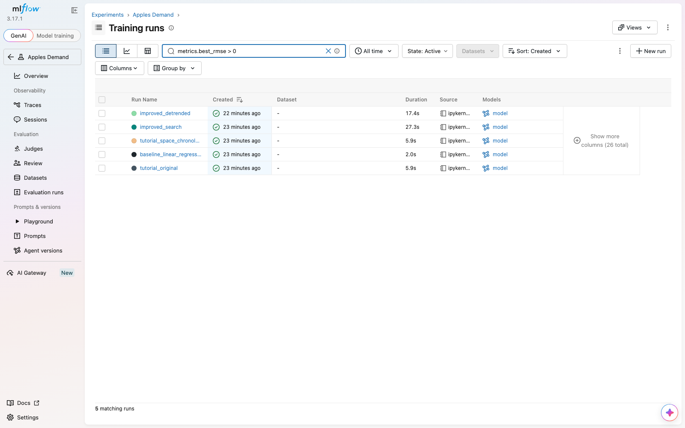
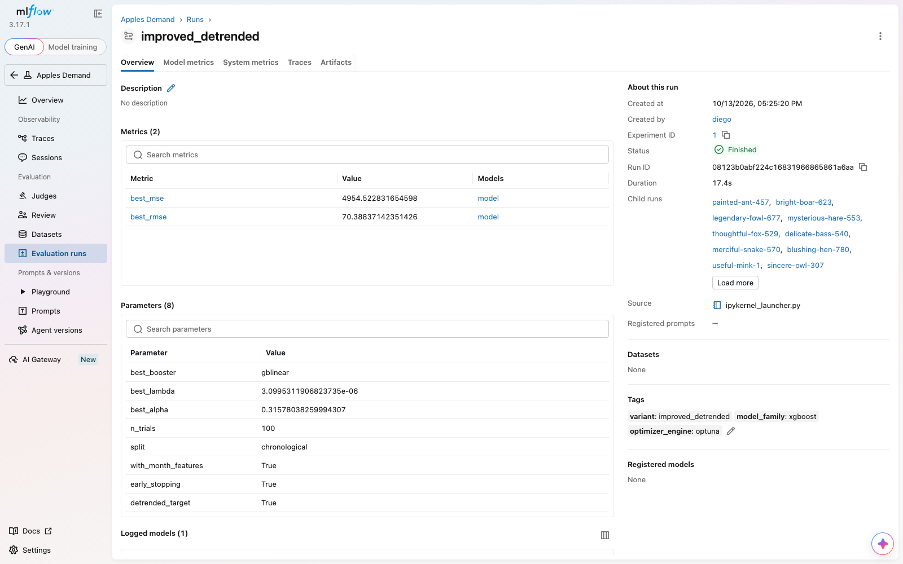
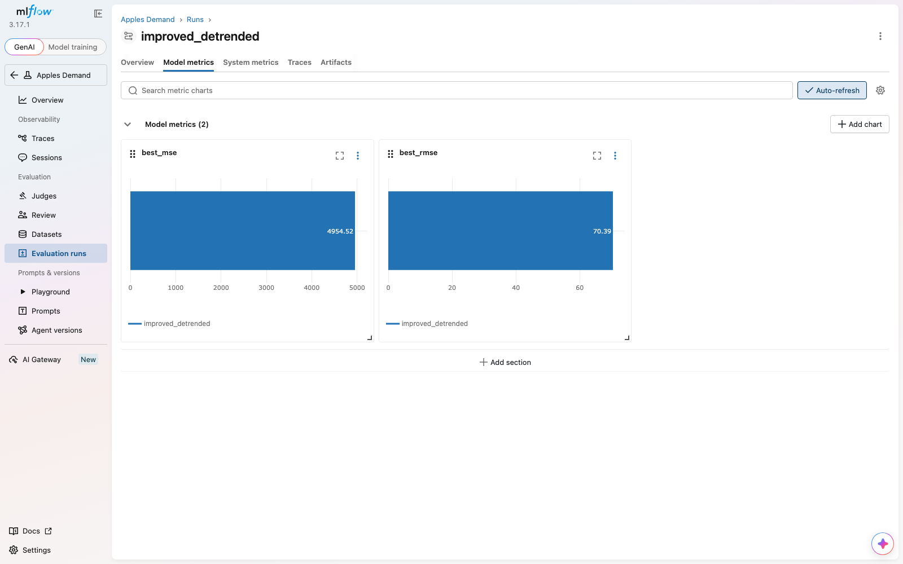
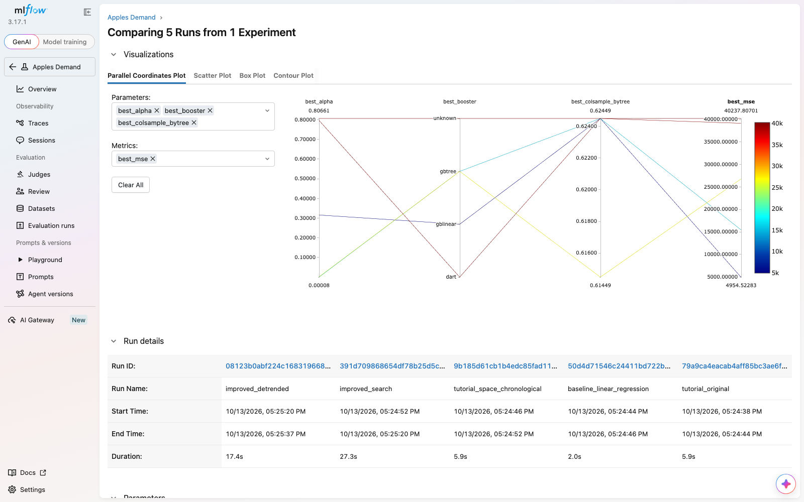
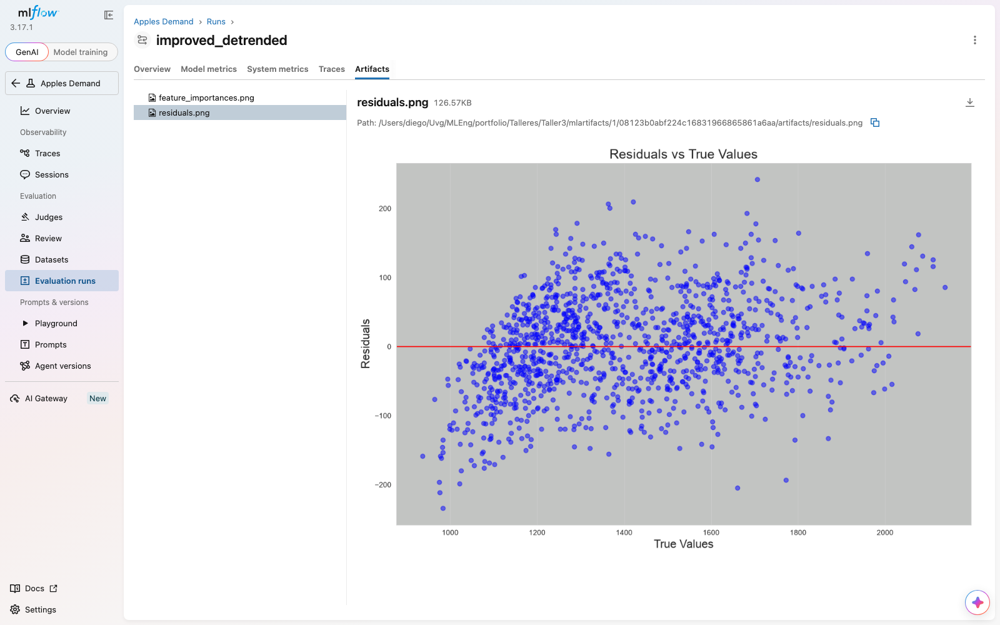
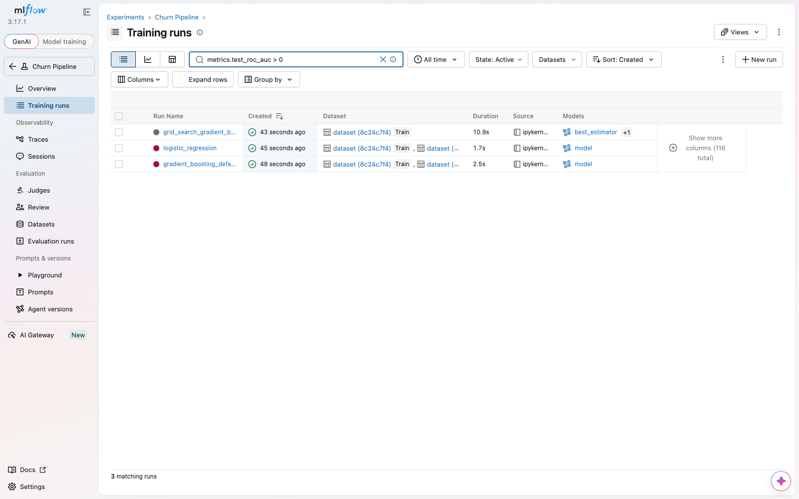
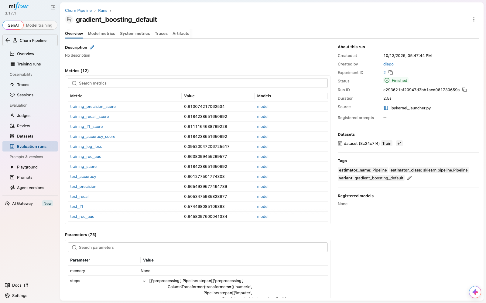
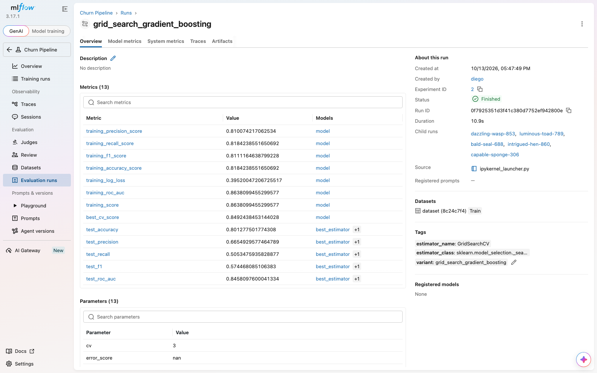

# Taller 3: MLflow con scikit-learn

Machine Learning Engineering (CC3105). Taller para conocer MLflow e integrarlo con un pipeline de scikit-learn.

Repositorio: https://github.com/SergioAle210/ML-Engineering/tree/main/Talleres/Taller3

## Contenido de la carpeta

| Archivo | Contenido | Sección de este documento |
|---|---|---|
| entrega.md | Este documento | Todas |
| notebooks/02_tutorial_jupyter_mlflow.ipynb | Tutorial en Jupyter y datos sintéticos | Inciso 2 |
| notebooks/03_pipeline_sklearn_mlflow.ipynb | MLflow con un pipeline de scikit-learn | Inciso 3 |
| capturas/ | Capturas de la interfaz de MLflow | Capturas |
| scripts/ | Generan los notebooks, los ejecutan y toman las capturas | Cómo reproducir |
| requirements.txt | Paquetes usados | Cómo reproducir |

## Qué es MLflow

MLflow guarda lo que pasa cuando se entrena un modelo. Registra parámetros, métricas y modelos de cada intento. Una interfaz web permite compararlos.

Términos que se usan en este documento:

1. **Experimento:** agrupa los intentos de un mismo problema.
2. **Run:** un intento de entrenamiento dentro de un experimento.
3. **Parámetro:** un valor elegido antes de entrenar.
4. **Métrica:** un resultado medido, como el error.
5. **Artefacto:** un archivo guardado en el run, como el modelo.

## Cómo reproducir

1. Crear y activar un ambiente virtual en esta carpeta (Python 3.12).
2. Instalar los paquetes con `pip install -r requirements.txt`. Esto instala también el pipeline del Taller 2 en modo editable. En macOS, XGBoost necesita `brew install libomp`.
3. Iniciar el servidor: `mlflow server --backend-store-uri sqlite:///mlflow.db --default-artifact-root ./mlartifacts --port 5000`.
4. Abrir http://127.0.0.1:5000 en el navegador.
5. Ejecutar los notebooks `02` y `03` de la carpeta `notebooks/`.
6. Opcional, para regenerar las capturas: `playwright install chromium` y `python scripts/take_screenshots.py`.

El experimento del inciso 2 se llama `Apples Demand` y el del inciso 3 `Churn Pipeline`.

## Inciso 1: Tres páginas de la documentación

### Página 1: Tracking Quickstart

Enlace: https://mlflow.org/docs/latest/ml/tracking/quickstart/

La elegimos por estas razones:

1. Reúne en un solo lugar los pasos básicos que se repiten en todo el taller.
2. Muestra el registro automático con `autolog` y el registro manual de parámetros y métricas.
3. Enseña a ver el run en la interfaz y a cargar el modelo para predecir.
4. Usa el dataset Iris, que es pequeño y fácil de seguir.

### Página 2: Guía de scikit-learn con MLflow

Enlace: https://www.mlflow.org/docs/3.5.0/ml/traditional-ml/sklearn/guide/

La elegimos por estas razones:

1. Responde directo al inciso 3. Su sección Advanced Features tiene una pestaña Pipeline Integration.
2. Explica que `autolog` registra los parámetros de cada paso del pipeline.
3. Explica cómo MLflow maneja la búsqueda de hiperparámetros. Ya hicimos una en la Actividad 1.

Usamos la versión 3.5.0 porque en la versión más reciente de esta guía no encontramos la sección de pipelines.

### Página 3: Model Registry

Enlace: https://mlflow.org/docs/latest/ml/model-registry/

La elegimos por estas razones:

1. Muestra qué pasa después de entrenar. El modelo se registra con un nombre y sus versiones.
2. Un alias como `champion` apunta a una versión. Se puede cambiar de versión sin tocar el código que usa el modelo.
3. Ayuda a pensar usos reales de MLflow.

## Inciso 2: Tutorial de MLflow en Jupyter

Tutorial seguido: MLflow with Optuna, Hyperparameter Optimization and Tracking.

Enlace: https://mlflow.org/docs/latest/ml/traditional-ml/tutorials/hyperparameter-tuning/notebooks/hyperparameter-tuning-with-child-runs/

Lo elegimos porque incluye la sección Generate our synthetic training data. El trabajo está en `notebooks/02_tutorial_jupyter_mlflow.ipynb`.

Pasos realizados:

1. Se levantó el servidor de MLflow con base SQLite y se apuntó el notebook a él con `mlflow.set_tracking_uri`.
2. Se generaron los 5000 días de datos sintéticos con la función del tutorial.
3. Se corrió la búsqueda con Optuna sobre XGBoost. Cada prueba es un run hijo dentro de un run padre, con sus parámetros, `mse` y `rmse`.
4. En el run padre se registraron los mejores parámetros, tags, la gráfica de correlación, la importancia de variables, los residuales y el modelo. El modelo se cargó de vuelta desde MLflow para predecir.

Se usaron **100 pruebas de Optuna** por búsqueda, no 500, para que cada experimento tarde menos de un minuto. Cada búsqueda queda en MLflow como 1 run padre más 100 hijos.

Correcciones mínimas al código del tutorial, necesarias con pandas 3: `fillna(..., inplace=True)` sobre una columna ya no modifica el DataFrame, así que se reasigna la columna. También se fijó `random_state` en la división de datos y la semilla del sampler de Optuna.

### Inciso 2a: Análisis de los datos sintéticos

Cómo se generan los datos según el tutorial:

1. La función `generate_apple_sales_data_with_promo_adjustment` crea 5000 filas por defecto.
2. Usa una semilla fija: `np.random.seed(9999)`.
3. El ruido sale de una distribución normal con media 0 y desviación 50.
4. Las variables son temperatura, lluvia, fin de semana, feriado, precio, promoción, demanda del día anterior, precio de la competencia e intensidad de marketing.
5. Los datos se dividen en 75 por ciento para entrenar y 25 por ciento para validar. No se ve una semilla en ese paso.
6. El modelo es XGBoost y Optuna busca sus parámetros.

Puntos a evaluar para mejorar el algoritmo:

1. Efecto de cambiar la semilla en los resultados.
2. Fijar `random_state` en la división de datos para poder repetirla.
3. Mezclar las filas al dividir, cuando existe una columna de fecha y una de demanda del día anterior.
4. Si un ruido fijo de 50 se parece al de un negocio real.
5. Comparar XGBoost contra un modelo base simple, como una regresión lineal.
6. Cuántas pruebas de Optuna hacen falta para ver una mejora real.

Defectos encontrados al analizar el tutorial, además de los puntos anteriores:

1. **La división aleatoria da un error optimista.** Los datos son una serie de tiempo diaria con `previous_days_demand`. Al mezclar los días, el set de entrenamiento incluye días posteriores a los de validación. En producción solo se conoce el pasado.
2. **La demanda crece cada año por un factor de inflación** del 3 por ciento. Con una validación cronológica los últimos años quedan por encima de todo lo visto en entrenamiento, y un árbol de decisión no extrapola.
3. **El espacio de búsqueda desperdicia pruebas.** `eta` baja hasta 1e-8 con solo 10 rounds de boosting, lo que deja árboles que casi no aprenden. El número de árboles no se busca.
4. **El generador elimina `month`**, aunque la demanda tiene estacionalidad anual.
5. **`marketing_intensity` casi no afecta la demanda.** Se suma con valores entre 0 y 1 a una demanda cercana a 1000. Es un defecto del generador, no del modelo.
6. **No hay modelo de referencia** para saber si XGBoost aporta algo.

Cada mejora se registró como un run nuevo en el experimento `Apples Demand`. Todos los runs cronológicos se evalúan sobre el **mismo 25 por ciento final de los días**, por lo que son comparables entre sí. El run `tutorial_original` usa la división aleatoria del tutorial y por eso no es comparable con los demás.

| Run | Qué cambia | RMSE de validación |
|---|---|---|
| `tutorial_original` | Código del tutorial, división aleatoria | 124.4 (optimista) |
| `baseline_linear_regression` | Regresión lineal, división cronológica | 197.9 |
| `tutorial_space_chronological` | Espacio de búsqueda del tutorial, división cronológica | 200.6 |
| `improved_search` | Espacio corregido (`eta` entre 0.01 y 0.5, `subsample`, `colsample_bytree`, `min_child_weight`), hasta 1000 rounds con early stopping, variables `month` y `day_of_week` | 163.6 |
| `improved_detrended` | Lo anterior, más `year_index` y un objetivo sin tendencia | **70.4** |

Qué se aprende de la tabla:

1. El error de 124.4 del tutorial se debe en buena parte a la división aleatoria. Con una validación realista el mismo algoritmo da 200.6.
2. XGBoost con el espacio de búsqueda del tutorial no le gana a una regresión lineal simple (200.6 contra 197.9). Sin el modelo de referencia esto no se habría notado.
3. Corregir el espacio de búsqueda y agregar `month` baja el error a 163.6, pero la mayor parte del error restante viene de la tendencia.
4. Estimar el crecimiento anual en el set de entrenamiento, entrenar con la demanda dividida entre ese factor y volver a multiplicar al predecir baja el error a 70.4. El ruido del generador es una normal con desviación 50 multiplicada por la inflación, así que el mínimo alcanzable ronda 55 a 65. El resultado queda cerca de ese límite.

Límites de este análisis: se usó una sola división cronológica y una sola semilla por búsqueda. La diferencia entre los runs grandes (de 200 a 70) es mucho mayor que la variación entre ejecuciones, que fue de menos de 1 punto de RMSE en las repeticiones, pero la diferencia entre `tutorial_space_chronological` y `baseline_linear_regression` (2.7 puntos) no es concluyente.

## Inciso 3: MLflow con un pipeline de scikit-learn

La sección de la documentación está en la página 2: Advanced Features, pestaña Pipeline Integration.

La documentación indica que al activar `mlflow.sklearn.autolog()` antes de entrenar, MLflow registra los parámetros de cada paso del pipeline. También captura las métricas de `score`.

Pipeline usado: el de churn de la Actividad 1, copiado en `Talleres/Taller2/pipeline`. El trabajo está en `notebooks/03_pipeline_sklearn_mlflow.ipynb`.

Qué se implementó:

1. Se cargó el dataset Telco Customer Churn con las funciones del paquete (`load_raw_data`, `build_cleaning_pipeline`, `split_dataset`). El conjunto de entrenamiento tiene 5634 filas y el de prueba 1409.
2. Se activó `mlflow.sklearn.autolog()` antes de entrenar y se llamó a `fit` sobre `build_model_pipeline(...)`, que es un `Pipeline` de dos pasos: `preprocessing` (`ColumnTransformer`) y `classifier`.
3. Se entrenaron dos pipelines, uno con `GradientBoostingClassifier` y otro con `LogisticRegression`. A cada run se le agregaron las métricas sobre el set de prueba con `evaluate_model` del paquete.
4. Se ejecutó `tune_model` (un `GridSearchCV` sobre el pipeline completo) con la autolog activa.
5. Se cargó el modelo guardado desde el run, con `mlflow.sklearn.load_model` y con `mlflow.pyfunc.load_model`, y se predijo sobre filas crudas.

Qué se observa en la interfaz:

1. Cada `fit` creó un run con 75 parámetros, que incluyen los de cada paso del pipeline con su prefijo (`classifier__n_estimators`, `classifier__max_depth`, imputadores, escaladores y codificador). Nadie los registró a mano.
2. Se registraron solas las métricas de entrenamiento (`training_roc_auc`, `training_f1_score`, `training_log_loss`, entre otras) y artefactos: matriz de confusión, curva ROC, curva precisión-recall y un diagrama HTML del pipeline (`estimator.html`).
3. El pipeline completo se guardó como modelo, con el preprocesamiento incluido. Por eso se puede predecir con filas crudas.
4. El `GridSearchCV` creó un run padre y runs hijos con el puntaje de validación cruzada de cada combinación. La autolog solo guarda los 5 mejores de las 18 combinaciones (`max_tuning_runs=5` por defecto).

| Run | roc_auc | f1 | recall | precision | accuracy |
|---|---|---|---|---|---|
| `gradient_boosting_default` | 0.8458 | 0.5745 | 0.5053 | 0.6655 | 0.8013 |
| `logistic_regression` | 0.8419 | 0.6040 | 0.5588 | 0.6572 | 0.8055 |
| `grid_search_gradient_boosting` | 0.8458 | 0.5745 | 0.5053 | 0.6655 | 0.8013 |

La búsqueda en rejilla encontró los mismos hiperparámetros que ya traía el pipeline por defecto, ya que ese valor salió de una búsqueda de la Actividad 1. Por eso las dos filas de gradient boosting son idénticas. La regresión logística queda a menos de medio punto de ROC AUC y tiene mejor recall y F1, así que el modelo más complejo casi no aporta en este dataset.

## Capturas de MLflow

Todas están en [capturas/](capturas/).

### Inciso 2: experimento `Apples Demand`

| Archivo | Qué muestra |
|---|---|
| `01_apples_lista_de_runs.png` | Los 5 runs padre del experimento |
| `02_apples_run_mejorado_detalle.png` | Parámetros, métricas y tags del run `improved_detrended` |
| `03_apples_run_mejorado_metricas_modelo.png` | Gráficas de `best_mse` y `best_rmse` de ese run |
| `04_apples_comparacion_de_runs.png` | Comparación de los 5 runs, con la gráfica de coordenadas paralelas |
| `07_apples_run_mejorado_residuales.png` | Gráfica de residuales guardada como artefacto |

<figure>
<figcaption><strong>Lista de runs del experimento Apples Demand</strong></figcaption>

</figure>

<figure>
<figcaption><strong>Parámetros, métricas y tags del run improved_detrended</strong></figcaption>

</figure>

<figure>
<figcaption><strong>Métricas best_mse y best_rmse del run improved_detrended</strong></figcaption>

</figure>

<figure>
<figcaption><strong>Comparación de los 5 runs del inciso 2</strong></figcaption>

</figure>

<figure>
<figcaption><strong>Gráfica de residuales guardada como artefacto</strong></figcaption>

</figure>

### Inciso 3: experimento `Churn Pipeline`

| Archivo | Qué muestra |
|---|---|
| `05_churn_lista_de_runs.png` | Los 3 runs padre: dos entrenamientos y la búsqueda en rejilla |
| `06_churn_run_pipeline_detalle.png` | Métricas y parámetros del pipeline registrados por autolog |
| `08_churn_grid_search_detalle.png` | Run padre del `GridSearchCV`, con sus runs hijos |

<figure>
<figcaption><strong>Runs del experimento Churn Pipeline</strong></figcaption>

</figure>

<figure>
<figcaption><strong>Métricas y parámetros del pipeline registrados por autolog</strong></figcaption>

</figure>

<figure>
<figcaption><strong>Run padre del GridSearchCV con sus runs hijos</strong></figcaption>

</figure>

## Conclusiones

1. **Lo que más se aprovechó fue poder comparar.** En el inciso 2 hubo cinco variantes del mismo experimento. Sin MLflow habrían sido cinco celdas con números sueltos que se pisan al volver a ejecutar. Con MLflow quedó cada variante con sus parámetros, su métrica y sus gráficas, y la comparación mostró algo útil: el algoritmo del tutorial no le gana a una regresión lineal cuando la validación es realista.
2. **Registrar métricas obliga a mirar cómo se mide.** Al comparar los runs apareció que la división aleatoria del tutorial daba un error optimista. Un número en un run no sirve si no se sabe con qué división se obtuvo, por eso conviene registrar también cómo se partieron los datos (`split` quedó como parámetro).
3. **La integración con scikit-learn cuesta una línea.** Con `autolog` se registraron 75 parámetros del pipeline, métricas, curvas, el diagrama y el modelo completo con su preprocesamiento. Guardar el `Pipeline` entero, y no solo el clasificador, evita el error típico de aplicar mal el preprocesamiento al predecir.
4. **Qué se usaría primero en proyectos propios:** el registro de runs. Es lo que resuelve el problema inmediato de saber cuál intento fue el mejor y cómo se obtuvo. El Model Registry tiene sentido cuando un modelo ya se sirve a alguien y hace falta versionarlo, por ejemplo con un alias `champion`. En un proyecto personal o de curso no hace falta todavía. En un proyecto profesional sí, porque permite cambiar de versión sin tocar el código que consume el modelo.
5. **Usos concretos:** el pipeline de churn podría registrar cada reentrenamiento mensual y avisar si la métrica baja. Los experimentos de tesis o de otros cursos de la carrera podrían llevar una bitácora reproducible de cada configuración probada.
6. **Dificultades:**
   - XGBoost en macOS requiere instalar `libomp` aparte.
   - Con pandas 3, el código del tutorial dejó de funcionar por `fillna(..., inplace=True)`.
   - Un experimento con cientos de runs hijos llena la lista, y hubo que filtrar por una métrica para ver solo los padres.
   - La autolog solo guarda los 5 mejores runs de una búsqueda por defecto, así que el resto de las combinaciones no queda registrado.
   - Un servidor con SQLite sirve para trabajo individual. Para un equipo haría falta un servidor compartido y un almacenamiento de artefactos remoto.

## Fuentes

1. https://mlflow.org/docs/latest/ml/tracking/quickstart/
2. https://www.mlflow.org/docs/3.5.0/ml/traditional-ml/sklearn/guide/
3. https://mlflow.org/docs/latest/ml/model-registry/
4. https://mlflow.org/docs/latest/ml/traditional-ml/tutorials/hyperparameter-tuning/notebooks/hyperparameter-tuning-with-child-runs/
